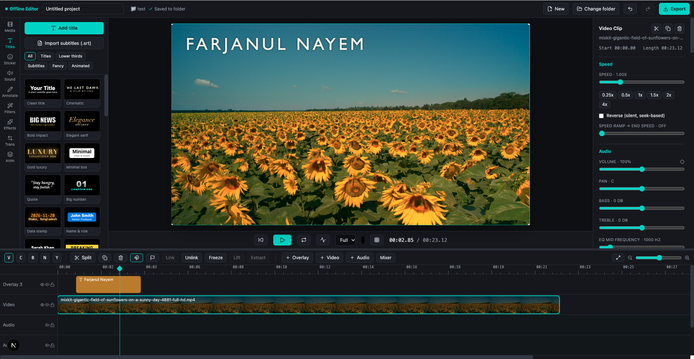

<div align="center">

# Offcut - Online browser based video editor

**A free, offline video editor that runs entirely in your browser.**
Cut, layer, colour-grade and export — your files never leave your computer.



</div>

---

Offcut is a desktop-class, browser-based video editor in the spirit of CapCut, VN, iMovie and Premiere Pro.
There is no server, no account and no upload: media is read from your disk, the project is saved to a folder you choose, and the final video is rendered locally.

## Why Offcut

- **100 % local.** Nothing is uploaded. The editor makes no network calls of its own.
- **Disk, not memory.** Media is streamed from files on disk and exports are streamed straight back to disk, so long projects don't need much RAM.
- **Your folder, your project.** Everything lives in a normal folder (`project.json`, `media/`, `exports/` …) that you can back up, sync or version however you like.
- **Serious editing tools** in a familiar multi-track timeline — not just trim-and-export.

## Features

**Editing**
- Multi-track timeline with unlimited **Overlay**, **Video** and **Audio** layers (rename, reorder, hide, mute, lock, resize)
- Drag / trim / split / duplicate, multi-select, link & group, snapping, markers, undo / redo
- Tools: selection, razor, ripple trim, rolling edit, slip
- Insert / overwrite, In/Out points with lift & extract, freeze frame, reverse, speed (0.1×–8×) and speed ramps
- Source monitor with In/Out marking, media search and bins, `.srt` subtitle import
- Auto-saved project with timed backups

**Titles & graphics**
- **44 two-line title styles** — titles, lower thirds, subtitles, fancy and animated looks
- Per-line styling, gradients, glow, outline, boxes, letter spacing, 14 fonts
- Text animations (typewriter, letter / word effects, blur-in…) and looping motion (wave, pulse, rainbow, glitch…)
- Stickers, shapes and **annotations** drawn straight on the video (arrow, box, circle, pen, highlight, spotlight, numbered markers, “draw-on” reveal)

**Transitions, effects & colour**
- 17 clip-to-clip **transitions** (dissolve, dip, wipes, push, slide, zoom, spin, iris, clock…)
- Effects: RGB split, glitch, film grain, sharpen, emboss, edge, posterize, duotone, glow, lens flare, pixelate, chroma key
- Filters, curves, colour wheels, temperature / tint, **3D LUT (`.cube`)** support, adjustment layers
- Masks, track mattes, crop with preset aspect ratios (1:1, 4:3, 9:16, 16:9, 21:9 …), blend modes
- Keyframes for position, scale, rotation, opacity and volume
- Live scopes: waveform, histogram, vectorscope

**Audio**
- Waveforms, fades, pan, EQ, compressor, de-esser, reverb, noise gate, auto-ducking
- Crossfades on transitions, voice-over recording
- **27 built-in sound effects**, synthesised locally (no downloads)
- Mixer with per-layer volume and a master meter

**Export**
- **Fast offline export** — H.264 + AAC in an MP4, rendered frame-by-frame with WebCodecs (not tied to real time)
- Real-time export (MP4 / WebM), audio-only WAV, single-frame PNG
- Resolution (480p – 4K), bitrate and In/Out-range options; files are written straight to `exports/`

## Browser support

| Browser | Status |
| --- | --- |
| Chrome / Edge (desktop) | ✅ Full support — **recommended** |
| Safari / Firefox | ⚠️ Limited — no local-folder access; some effects and fast export are unavailable |

Offcut needs the [File System Access API](https://developer.mozilla.org/docs/Web/API/File_System_API) to save into a folder, plus WebCodecs for fast export.
It is a desktop-layout app (min. width ≈ 1100 px).

## Getting started

Requirements: **Node.js 20+** and npm.

```bash
git clone git@github.com:farjanul/offcut-video-editor.git
cd offcut-video-editor
npm install
npm run dev
```

Open **http://localhost:3000** in a normal **Chrome or Edge** window, click **Choose folder** and pick a **new, empty folder** for your project.

> The folder picker does not work inside embedded / preview panes (for example an IDE’s built-in browser), and Chrome refuses system folders such as *Desktop*, *Documents* or *Downloads* — create a dedicated folder like `MyVideoProject` instead.

Production build:

```bash
npm run build
npm start
```

## Project folder layout

```
MyVideoProject/
├── project.json     # the project (tracks, clips, settings)
├── media/           # imported video / audio / images (also scanned for new files)
├── exports/         # rendered videos
├── cache/           # waveform caches
├── luts/            # imported .cube LUTs
└── backups/         # rolling project backups
```

Drop files into `media/` from Finder / Explorer at any time — Offcut picks them up when you return to the tab (or press the refresh button in the media panel).

## Keyboard shortcuts

| Key | Action | Key | Action |
| --- | --- | --- | --- |
| `Space` | Play / pause | `S` | Split at playhead |
| `J` `K` `L` | Shuttle back / pause / forward | `←` `→` | Step a frame (`Shift` = 1 s) |
| `V` `C` `B` `N` `Y` | Select / razor / ripple / roll / slip | `M` | Add marker |
| `I` `O` | Mark In / Out | `;` `'` | Lift / extract range |
| `Del` | Delete | `Shift+Del` | Ripple delete |
| `Ctrl/⌘ D` | Duplicate | `Ctrl/⌘ C` `V` | Copy / paste |
| `Ctrl/⌘ Z` | Undo (`Shift` = redo) | `Ctrl/⌘ G` | Link / group (`Shift` = unlink) |
| `Ctrl/⌘ S` | Save now | `Esc` | Leave annotate mode |
| `Ctrl/⌘ + scroll` | Zoom timeline | `Home` | Go to start |

## Tech stack

[Next.js](https://nextjs.org) 16 · React 19 · TypeScript · [Tailwind CSS](https://tailwindcss.com) v4 · [Zustand](https://github.com/pmndrs/zustand) · [lucide-react](https://lucide.dev) · [mp4-muxer](https://github.com/Vanilagy/mp4-muxer)

Rendering and audio use the browser itself: Canvas 2D, SVG filters, WebGL (LUTs), Web Audio, WebCodecs and the File System Access API.

```
src/
├── app/            # Next.js app shell
├── components/     # Timeline, preview, inspector, media panel, dialogs …
└── lib/
    ├── engine.ts   # playback, compositing, effects, audio graph, real-time export
    ├── exporter.ts # offline WebCodecs exporter
    ├── store.ts    # editor state & actions (Zustand)
    ├── effects.ts  # transitions, text styles, keyframes, helpers
    ├── sfx.ts      # synthesised sound effects
    └── fs.ts       # local-folder access
```

## Known limitations

- Real-time export records playback, so the tab must stay in the foreground; use **Fast** export when available.
- Fast export does not apply the noise gate or auto-ducking (they run in live playback and real-time export).
- Reversed clips are silent and cannot be trimmed (split or roll instead).
- Not (yet) included: nested / multiple sequences, multi-cam, stabilisation, automatic captions, HSL secondary colour.
- Effects rely on canvas filters and SVG filters, which are unavailable in Safari.

## Privacy

All processing happens on your machine. Offcut contains no analytics and sends no media or project data anywhere.
(Next.js itself collects anonymous build telemetry during development; turn it off with `npx next telemetry disable`.)
